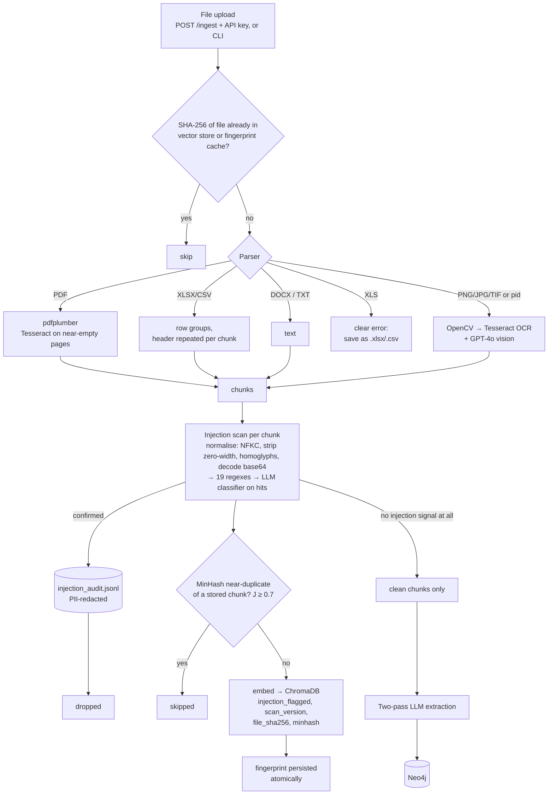
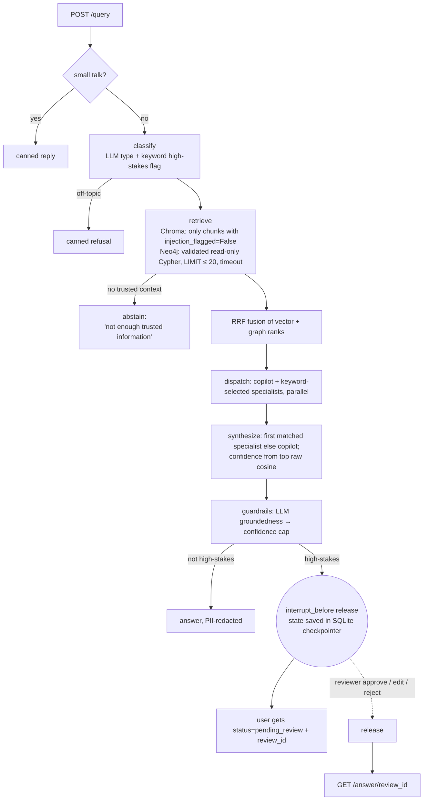

# Cerebra-CorpCortex

Cerebra answers natural-language questions over a plant's documents: maintenance manuals, work orders, inspection reports, SOPs, regulations, spreadsheets and P&ID diagrams. Each answer comes with source documents and a confidence label. Safety-critical answers are **held for a human reviewer** before anyone sees them.

Under the hood it's a LangGraph pipeline over a ChromaDB vector store and a Neo4j knowledge graph. Trust layers sit at both ingestion and query time.

> Status: research prototype, hardened on branch `fix/security-hardening`. Read **Limitations** before relying on any trust feature. Measured numbers are in [`EVAL_RESULTS.md`](EVAL_RESULTS.md).

---

## What it does

- **Ingests** PDF, DOCX, XLSX, CSV, TXT/EML and image files (P&IDs), through the CLI or `POST /ingest` (API key required).
- **Builds two indexes from trusted text only.** Embedded chunks go into ChromaDB. Entities and relationships go into Neo4j, extracted only from chunks that passed the injection scan.
- **Answers** questions via `POST /query`. A response carries:
  - the answer;
  - a status (`answered` / `abstained` / `pending_review`);
  - confidence and its label;
  - up to 8 source-document cards;
  - the graph path;
  - groundedness warnings.
- **Holds high-stakes answers** (LOTO, confined space, hot work, …) for a reviewer, who approves, edits or rejects them through `/review/*`. The user polls `GET /answer/{review_id}`.
- **Frontend:** Next.js chat UI in `frontend/`. Held answers show "pending review" and update when a reviewer decides.

---

## Architecture

### Ingestion path



### Query path



### Code map

| Area | Files |
|---|---|
| API, auth, rate limit | `backend/api/main.py`, `backend/api/security.py` |
| Orchestration, HITL | `backend/agents/supervisor.py`, `backend/review/queue.py` |
| Agents | `backend/agents/{base,copilot,maintenance,compliance,lessons_learned}.py` |
| Retrieval | `backend/retrieval/{classifier,vector_search,graph_search,cypher_guard,reranker}.py` |
| Ingestion | `backend/ingestion/{pipeline,extractor,dedup}.py`, `backend/ingestion/parsers/document_parsers.py` |
| Guardrails | `backend/guardrails/{injection_scanner,groundedness,severity,pii,audit_log}.py` |
| Eval | `backend/eval/{benchmark,probes,security_eval,eval_pipeline}.py` → `EVAL_RESULTS.md` |
| Tools | `scripts/rescan_store.py`, `scripts/smoke_test.py`, `scripts/fake_openai.py` |

---

## Trust layers

| Layer | Where | How it works | On a hit |
|---|---|---|---|
| **Write access** | `/ingest`, `/webhook/qms/incident`, `/eval/run` | API key (`Bearer` or `X-API-Key`, constant-time compare). Fails closed if not configured. Sliding-window rate limit per key and IP. Upload names reduced to their basename. | 401 / 503 / 429 |
| **1. Injection detection** | Ingestion, per chunk, after OCR and vision | Text is normalised first: NFKC, invisible characters (Unicode Cf) removed, Cyrillic and Greek homoglyphs mapped, base64 segments decoded two levels deep. Then 19 regexes. Regex hits go to a GPT-4o classifier, which sees the de-obfuscated text. | **Confirmed:** chunk dropped and audited. **Regex-flagged:** stored as `injection_flagged=True`, never retrieved, never sent to the graph. |
| **Trusted retrieval** | Query | Only chunks explicitly scanned clean are returned; unscanned chunks count as untrusted. LLM-written Cypher must be a single bounded read (no CREATE, MERGE, SET, DELETE, CALL, LOAD CSV, …). It runs in a `READ_ACCESS` session with a timeout. | Nothing trusted → abstain, with no LLM answer at all |
| **2. Groundedness** | Query, `guardrails` node | Second GPT-4o call, temperature 0, labels each claim supported, partial or unsupported against the retrieved context. | Any non-supported claim caps confidence at 0.75. More than 50% caps it at 0.40 (Low). Warning shown. |
| **3. Human review** | Query, `release` node | A deterministic rule (safety keyword in the question; `HITL_MODE=all` or `low_confidence`) routes the run to `release`. The graph is compiled with `interrupt_before=["release"]` and an SQLite checkpointer. | Answer **withheld**. A reviewer approves, edits or rejects it through `/review/*` (separate key). Each decision is claimed once and logged with reviewer and timestamp. |
| **4. PII redaction** | Every response, reviewer view and audit record | Regex for email, international and Indian phones (no partial leaks), Aadhaar (spaced, hyphenated or contiguous), PAN (any case). | `[REDACTED …]` |
| **Near-duplicate filter** | Ingestion | MinHash (64 permutations, word 3-shingles); a chunk at estimated Jaccard ≥ 0.7 to a stored chunk is skipped. File SHA-256 lives in chunk metadata, so a lost cache can't cause re-ingestion. | Chunk skipped |

**Confidence.** It isn't the LLM's own rating. One function (`base.compute_confidence`) maps the top **raw** cosine similarity onto bands: ≥ 0.72 is High (0.85–0.99) and ≥ 0.52 is Medium. Every agent uses it, and groundedness can only lower it. The bands are heuristic and uncalibrated.

**Audit trail**, written to `AUDIT_DIR` and PII-redacted:
- `injection_audit.jsonl`
- `escalation_audit.jsonl`
- `review_audit.jsonl`, with pending and decision events
- Neo4j `AuditLog` nodes for graph writes

---

## How to run

### Prerequisites
- Python 3.11, Node 18+
- Tesseract (`apt install tesseract-ocr`); OpenCV is optional
- Neo4j 5, local (`docker compose up -d neo4j`) or AuraDB
- An OpenAI API key

### Configure
```bash
cp .env.example .env
```
Then set these in `.env`:
- `OPENAI_API_KEY`
- `NEO4J_URI`, `NEO4J_USERNAME` and `NEO4J_PASSWORD`, used for ingestion writes
- `NEO4J_READ_USERNAME` and `NEO4J_READ_PASSWORD`, used for query-time reads (see below)
- `INGEST_API_KEY` and `REVIEWER_API_KEY`, as two **different** long random strings
- optionally `HITL_MODE=all|low_confidence`, `RATE_LIMIT_WRITES_PER_MIN`, `NEAR_DUP_JACCARD`, `CONFIDENCE_HIGH_SIM` and `CONFIDENCE_MEDIUM_SIM`

### Neo4j read-only user (recommended)
On Neo4j Enterprise or AuraDB tiers with role-based access:
```cypher
CREATE USER cerebra_reader SET PASSWORD 'change-me' CHANGE NOT REQUIRED;
GRANT ROLE reader TO cerebra_reader;
```
Set `NEO4J_READ_USERNAME=cerebra_reader`. Neo4j Community has no role-based access control. There, the retriever still uses a `READ_ACCESS` session plus the Cypher validator, but it authenticates as the main user.

### Backend
```bash
python3.11 -m venv .venv && source .venv/bin/activate
pip install -r requirements.txt
python -m backend.ingestion.pipeline --dir ./sample_docs      # ingest
uvicorn backend.api.main:app --port 8000                     # http://localhost:8000/docs
```
If an existing vector store predates the injection scanner, re-scan it with no re-embedding: `python -m scripts.rescan_store --apply`.

### Frontend
```bash
cd frontend && npm install && npm run dev                    # http://localhost:3000
```
For local uploads from the UI, set `NEXT_PUBLIC_INGEST_API_KEY`. That value ships to the browser, so it's for local demos only.

### Reviewing held answers
```bash
curl -H "X-API-Key: $REVIEWER_API_KEY" localhost:8000/review/pending
curl -X POST -H "X-API-Key: $REVIEWER_API_KEY" -H 'Content-Type: application/json' \
     -d '{"decision":"approve","reviewer":"j.doe"}' localhost:8000/review/<review_id>
# decision: approve | edit (+ "edited_answer") | reject (+ optional "note")
```

### Endpoints
| Method | Path | Auth | Purpose |
|---|---|---|---|
| POST | `/query` | none | answer, or `pending_review` + `review_id` |
| GET | `/answer/{review_id}` | none (unguessable uuid) | poll a held answer |
| GET | `/review/pending` | reviewer key | held answers with draft, confidence, unsupported claims, citations |
| POST | `/review/{review_id}` | reviewer key | approve / edit / reject |
| POST | `/ingest` | ingest key + rate limit | upload a document |
| POST | `/webhook/qms/incident` | ingest key + rate limit | write an incident event to the graph |
| POST / GET | `/eval/run`, `/eval/report` | key for run | Ragas eval |
| GET | `/graph/stats`, `/health` | none | stats, liveness |

### Tests and evaluation
```bash
pytest                                   # regression tests; LLM, Neo4j and OpenAI are mocked
python -m scripts.smoke_test             # boots the real API against a copy of data/chroma, stub OpenAI
python -m backend.eval.security_eval     # offline security metrics → EVAL_RESULTS.md
python -m backend.eval.security_eval --online   # + retrieval hit rate, groundedness, latency (needs a key)
```
Each fix has a test file named `tests/test_fixNN_*.py`. `tests/test_known_gaps.py` pins the documented gaps as strict xfails.

---

## Limitations

These are current as of `fix/security-hardening`. Each one is real and checked against the code.

### Access and identity
- **Read access isn't authenticated or authorized.** `/query`, `/answer/{id}` and `/graph/stats` are open, and `session_id` is still ignored. There's no per-user identity and no retrieval-time access control. The ontology's `role_tag` is still always `"general"` and never filtered, and graph traversal isn't filtered per hop.
- **Keys are shared, not per person.**
  - API keys are static and shared: one ingest key, one reviewer key. The reviewer name in a decision is self-declared, not authenticated.
  - Rate limiting is in-process: per worker, and reset on restart.
  - `/answer/{id}` is protected only by the uuid being unguessable.
- **The read-only Neo4j user is documented but not enforced by the code.** The fallback is the admin credentials in a `READ_ACCESS` session. The default password is still `industrialiq123` in `config.py` and `docker-compose.yml`, and APOC is unrestricted in the local compose file.
- **Graph labels and edge types from the extraction LLM** are still interpolated into Cypher writes without an ontology allowlist (`writer.py`). Node properties are still last-writer-wins.
- **Data still leaves the boundary.** Company data goes to OpenAI unredacted: chunks, documents, images and context. PII protection covers what leaves the backend (responses and logs), not what's sent to OpenAI or stored in Chroma or Neo4j.

### Trust layers
- **Injection detection** is still regex-first. On the audit probe set (`EVAL_RESULTS.md`), these still pass the regex:
  - non-English text (Hindi, French);
  - paraphrased instructions;
  - text aimed at the groundedness verifier;
  - plain markdown links;
  - instructions split across chunks.

  Also, the LLM classifier only sees regex hits and fails open, user questions and graph text aren't scanned, and there's no assembled-context scan at query time.
- **Groundedness:**
  - It judges the whole answer against pooled context; it doesn't verify claim-to-citation.
  - It's an instruction-following LLM, so it can be injected.
  - It fails open, and it warns rather than blocks for non-high-stakes answers.
- **Human review:**
  - The trigger is a keyword list on the question, so paraphrases like "isolate energy on C-202" bypass it.
  - There's no notification (the reviewer must poll the queue), no SLA or timeout for held answers, and no queue prioritisation.
- **PII:**
  - Regex only. Names, employee IDs, dates of birth and bank details aren't detected (NER needed).
  - The 12-digit Aadhaar pattern also redacts other 12-digit numbers.

### Answer quality
- **Confidence is uncalibrated.** The bands (0.72 / 0.52 cosine) are heuristic, and no reliability diagram or ECE exists.
- **Citations are retrieval provenance, not per-claim attribution.**
- **Agents:**
  - Routing is by keyword. All agents get identical context and have no tools.
  - One answer is kept: the first specialist matched, otherwise the copilot.
- **Reranking:** the reranker still keeps one chunk per `doc_id`. No BM25 and no cross-encoder.

### Ingestion
- `.xls` is rejected; save it as `.xlsx` or `.csv`. Images embedded inside PDFs aren't processed. Only the first 12,000 characters of clean text go to graph extraction.
- **Near-duplicate filter:**
  - It catches 88% of 3-word-edited copies but only 20% of 10-word-edited ones (`EVAL_RESULTS.md`). Heavily paraphrased copies pass.
  - The lookup is a linear scan; production would need LSH.
- **Store re-scan:** `rescan_store.py` marks every regex hit as flagged, because no LLM second pass runs offline. The committed store had none.

### Evaluation
- Offline security metrics are measured. **Retrieval hit rate, groundedness pass rate and end-to-end latency are not measured yet**, because they need an OpenAI key (`--online`).
- The Ragas pipeline needs `ragas` and `datasets` installed, and hasn't been re-run since the benchmark was fixed.
- The smoke test uses a stub OpenAI server, so it proves the wiring, not answer quality.
