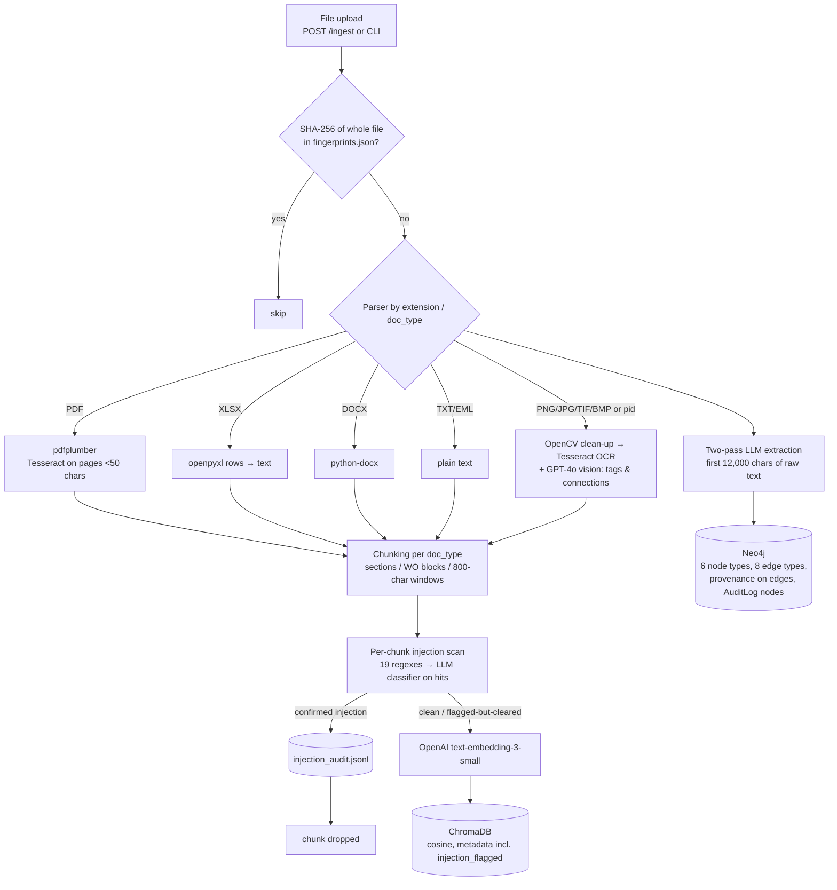
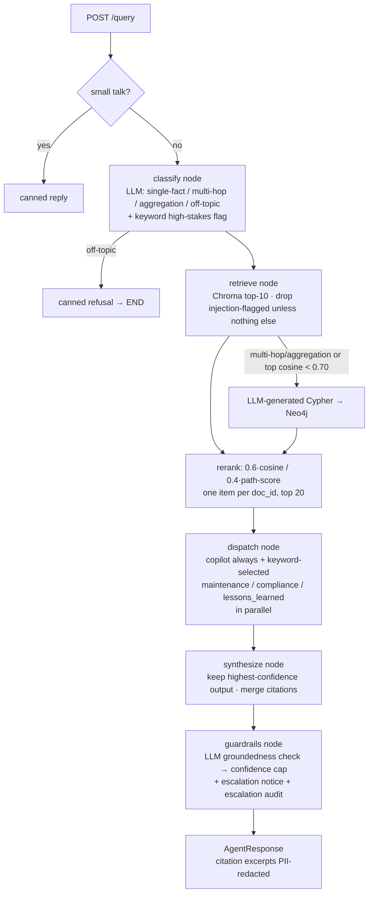

# Cerebra-CorpCortex

Cerebra answers natural-language questions over a plant's documents, such as maintenance manuals, work orders, inspection reports, SOPs, regulations and P&ID diagrams. Each answer comes with source documents, a confidence label and safety notices. Under the hood it's a LangGraph pipeline over a ChromaDB vector store and a Neo4j knowledge graph, with a guardrails layer (injection scanning, groundedness checking, high-stakes flagging, PII redaction and audit logs).

> Status: research prototype. Read **Limitations** before relying on any of the trust features.

---

## What it does

- **Ingests** PDF, DOCX, XLSX, TXT/EML, and image files (P&IDs), via a CLI or `POST /ingest`.
- **Builds two indexes:** text chunks embedded in ChromaDB, plus entities and relationships extracted into Neo4j with per-edge provenance.
- **Answers** questions via `POST /query` with:
  - the answer text;
  - a confidence score and High/Medium/Low label;
  - up to 8 source-document cards;
  - the graph path (when the graph was used);
  - a groundedness warning;
  - a safety escalation notice.
- **Frontend:** Next.js chat UI in `frontend/`.

---

## Architecture

### Ingestion path



Note that graph extraction (H) reads the parsed text directly, **not** the scanned chunks. See Limitations.

### Query path



Code map:

| Area | Files |
|---|---|
| API | `backend/api/main.py` |
| Orchestration | `backend/agents/supervisor.py` |
| Agents | `backend/agents/{base,copilot,maintenance,compliance,lessons_learned}.py` |
| Retrieval | `backend/retrieval/{classifier,vector_search,graph_search,reranker}.py` |
| Ingestion | `backend/ingestion/{pipeline,extractor}.py`, `backend/ingestion/parsers/document_parsers.py` |
| Graph | `backend/graph/writer.py`, `backend/shared/ontology.py` |
| Guardrails | `backend/guardrails/{injection_scanner,groundedness,severity,pii,audit_log}.py` |
| Eval | `backend/eval/eval_pipeline.py` |

---

## The four trust layers

| Layer | Where it runs | How it works | What happens on a hit |
|---|---|---|---|
| **1. Prompt-injection detection** | Ingestion, per chunk, after OCR/vision | 19 regex patterns (`PATTERN_VERSION 2.0`). Chunks that match go to a GPT-4o classifier that separates attacks from industrial phrasing such as "disregard the previous reading". At query time, all context is wrapped in `<retrieved_context>` with a "data, not instructions" preamble. | **Confirmed:** chunk not embedded, logged to `data/injection_audit.jsonl`. **Cleared:** embedded with `injection_flagged=true` and excluded at retrieval when clean alternatives exist. |
| **2. Groundedness verification** | Query, final graph node | A second GPT-4o call (temperature 0, JSON) classifies each claim in the answer as supported, partial or unsupported against the retrieved context. | Any non-supported claim caps confidence at 0.75 (High→Medium). More than 50% unsupported caps it at 0.40 (Low). Unsupported claims are returned in `groundedness_warning`, and the UI shows an amber note. The answer is still returned. |
| **3. High-stakes flagging** | Query: keyword check at classify, decision at the guardrails node | 20 safety keywords in the question (LOTO, confined space, hot work, gas leak, relief valve, …), combined with a Medium or Low confidence label. | `escalation_notice` → orange banner above the answer advising verification by a qualified engineer. Every high-stakes query is logged to `data/escalation_audit.jsonl`. |
| **4. PII redaction** | Response, citation excerpts | Regex for email, phone (Indian and US formats), Aadhaar (spaced) and PAN (uppercase). | Matching text in the 200-character citation excerpt is replaced with `[REDACTED …]`. Stored data is unchanged. |

**Audit:** the two JSONL files above, plus a Neo4j `AuditLog` node for every graph node or edge write.

**Confidence:** this isn't the LLM's own rating. For the copilot it comes from the top retrieval score. For specialists it's a fixed per-agent value. The groundedness caps above then apply.

---

## How to run

### Prerequisites
- Python 3.11+, Node 18+
- Tesseract OCR binary (`apt install tesseract-ocr` or the UB-Mannheim build on Windows). OpenCV is optional.
- Neo4j 5: local through `docker compose up -d neo4j`, or AuraDB
- An OpenAI API key

### Configure
```bash
cp .env.example .env
# set OPENAI_API_KEY, NEO4J_URI, NEO4J_USERNAME, NEO4J_PASSWORD
# on Linux/macOS, remove or fix the Windows TESSERACT_CMD line
```
Retrieval and guardrail settings live in `backend/config.py`: `VECTOR_TOP_K`, `GRAPH_HOP_LIMIT`, `RETRIEVAL_CONFIDENCE_THRESHOLD`, reranker weights, and the `GROUNDEDNESS_*` caps.

### Backend
```bash
python -m venv .venv && source .venv/bin/activate
pip install -r requirements.txt
python check_setup.py                                    # dependency + Neo4j check

# ingest documents (doc type inferred from extension)
python -m backend.ingestion.pipeline --dir ./sample_docs
python -m backend.ingestion.pipeline --file ./sample_docs/work_order_P101_2024.txt --doc-type work_order

uvicorn backend.api.main:app --reload --port 8000        # docs at http://localhost:8000/docs
```

### Frontend
```bash
cd frontend && npm install && npm run dev                # http://localhost:3000
```

### Endpoints
| Method | Path | Purpose |
|---|---|---|
| POST | `/query` | `{"question": "..."}` → answer, citations, confidence, guardrail fields |
| POST | `/ingest` | multipart `file` + `doc_type` |
| POST | `/webhook/qms/incident` | write an incident Event directly into the graph |
| GET | `/graph/stats` | node counts by label, edge count |
| POST / GET | `/eval/run`, `/eval/report` | run and read the Ragas eval |
| GET | `/health` | liveness |

### Optional: eval
```bash
python -m backend.eval.eval_pipeline          # writes data/eval/latest_report.json
```
Read the eval limitations below before quoting any number from it.

---

## Limitations

This section is intentionally complete. Each item has been checked against the code.

### Security and access
- **No authentication or authorization** on any endpoint. `session_id` is accepted and ignored. Anyone who can reach the API can query everything, upload documents, write to the graph through `/webhook/qms/incident`, and trigger paid eval runs. The deployed config sets CORS to `*`.
- **No retrieval-time access control.** Chroma queries have no metadata filter. The ontology defines `role_tag` but it is always `"general"` and never enforced. Graph traversal can reach any node.
- **LLM-generated Cypher runs in a write-capable session using the configured (admin) Neo4j user.** There's no read-only mode, no query allowlist and no DB timeout. The default Neo4j password is hard-coded in `config.py` and `docker-compose.yml`, and the local compose file enables unrestricted APOC.
- **Graph labels and edge types proposed by the LLM** are interpolated into Cypher without checking them against the ontology.
- **Upload filenames** are used unsanitized as on-disk paths.
- **Company data leaves the boundary to OpenAI, unredacted:** every chunk (embeddings), document text (extraction), diagram images (vision), and retrieved context on every query.

### Trust layers
- **Injection detection** only gates ChromaDB:
  - Graph extraction reads the raw text, including blocked chunks.
  - The regex misses obfuscation (zero-width, homoglyphs, base64, non-English), paraphrase and split instructions.
  - The LLM classifier runs only on regex hits and fails open.
  - Flagged chunks are returned when they are the only hits.
  - User questions and graph text are never scanned.
  - The committed demo vector store was built before the scanner existed.
- **Groundedness:**
  - It judges the whole answer against pooled context; it does not verify individual citations.
  - It's an instruction-following LLM reading untrusted text, so it can be injected.
  - It fails open on errors, and it's skipped when retrieval returns nothing.
  - It never blocks, retries or abstains.
  - The UI doesn't show which claims failed.
- **High-stakes flagging:**
  - It's a keyword list on the question, so paraphrases bypass it.
  - Because the label can't reach High (see Confidence), every keyword match escalates.
  - **No human is in the loop:** no notification, queue, or LangGraph interrupt. The answer is shown immediately alongside the banner.
- **PII redaction:**
  - Display-only, on 200-character citation excerpts.
  - Not applied to the answer, embeddings, graph, LLM calls or logs.
  - Misses names, unspaced Aadhaar, lowercase PAN, employee IDs, DOB and bank details.
  - Can leak the last digit of `+91` numbers and can redact part numbers as phones.
- **Audit logs:**
  - They cover injection events, high-stakes queries and graph writes only, not general queries or answers.
  - They contain raw queries and raw chunk previews.
  - They're not tamper-evident.
  - On ephemeral hosting they're lost on redeploy.

### Answer quality
- **Confidence is uncalibrated and mis-scaled.**
  - Copilot thresholds assume raw cosine but receive `0.6 × cosine`, so the maximum is about 0.70 and "High" is unreachable for retrieved answers.
  - Specialist agents return constants (0.80 / 0.78 / 0.75).
- **Citations** are the top retrieved documents, not sources attributed per claim. The copilot's `citation_note` is unverified free text. Graph-sourced items appear as "Unknown Document".
- **Agents:**
  - Routing is by keyword.
  - All agents get identical context and have no tools.
  - Synthesis keeps only the highest-confidence output, so a specialist's answer always replaces the copilot's when one runs.
  - Agents don't see each other's output.
- **LangGraph usage is minimal:** a linear graph with one conditional edge. No checkpointer, interrupt or reducers. Parallelism is `asyncio.gather` inside one node.

### Retrieval and ingestion
- **"Hybrid" means** vector plus text-to-Cypher, fused by a weighted sum of incomparable scores. No BM25, no RRF, no cross-encoder. Dedup keeps one chunk per `doc_id`.
- **Dedup is whole-file SHA-256 only.** Near-duplicates and re-uploads under a new hash are not caught. The committed demo store contains several files 3–4 times.
- **Spreadsheets:** `.csv` and `.xls` fail, because openpyxl reads only `.xlsx`. Sheets get generic 800-character chunks without repeated headers.
- **Diagrams:** vision (GPT-4o) runs only on standalone image files, with a P&ID-specific prompt. Images embedded in PDFs are ignored.
- **Knowledge graph:**
  - Built from only the first 12,000 characters of each document.
  - No entity resolution beyond identical LLM-chosen IDs.
  - Node properties are last-writer-wins, so a later upload can overwrite facts.
  - The ontology isn't enforced at write time.
- **No timeouts, `max_tokens` or per-user cost budgets** on LLM calls.

### Evaluation
- There are **no automated tests**.
- The Ragas script has 5 questions, and **3 of their ground truths reference equipment not in the corpus**. It passes citation snippets, not retrieved contexts, to Ragas.
- **No eval report or latency measurements** are committed. The cost of the trust layers (mainly one extra GPT-4o call per query) has not been measured.
